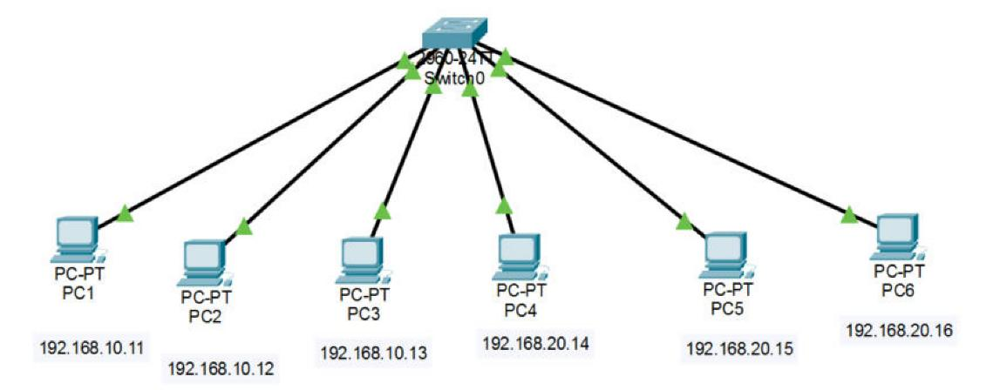
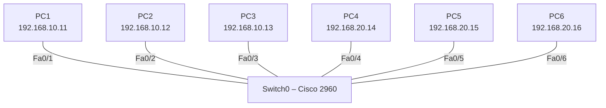

# Segmentation VLAN sur un switch – Contrôle réseaux (partie A)

Contrôle de réseaux réalisé à l'ESAIP (IR3), partie A : segmentation d'un réseau local en deux VLAN sur un seul switch Cisco 2960 afin d'isoler deux groupes d'utilisateurs.


## Topologie

### Capture Packet Tracer



### Schéma logique



## VLAN et adressage

| VLAN | Réseau | Postes |
|---|---|---|
| 10 | 192.168.10.0 /24 | PC1, PC2, PC3 |
| 20 – *financier* | 192.168.20.0 /24 | PC4, PC5, PC6 |

Il n'y a pas de routeur dans cette partie : les deux VLAN sont volontairement isolés, aucun trafic ne passe de l'un à l'autre.

## Configuration type

```cisco
vlan 20
 name financier
!
interface FastEthernet0/1
 switchport mode access
 switchport access vlan 10
!
interface FastEthernet0/4
 switchport mode access
 switchport access vlan 20
```

Toutes les configurations sont regroupées dans [`CONFIGURATIONS.md`](CONFIGURATIONS.md).

## Compétences mises en œuvre

- Création et nommage de VLAN
- Affectation de ports en mode access
- Isolation de domaines de broadcast
- Vérification : `show vlan brief`, tests de `ping` intra-VLAN et inter-VLAN

## Utilisation

Ouvrir [`controle-vlan-partie-a.pkt`](controle-vlan-partie-a.pkt) avec **Cisco Packet Tracer 8.2** ou plus récent.

## Voir aussi

- [Partie C – VLAN répartis sur deux switchs avec trunk 802.1Q](https://github.com/Anatole-1/packet-tracer-vlan-8021q-trunk)

## Contenu du dossier

| Élément | Description |
|---|---|
| [`controle-vlan-partie-a.pkt`](controle-vlan-partie-a.pkt) | Fichier Cisco Packet Tracer du projet |
| [`CONFIGURATIONS.md`](CONFIGURATIONS.md) | Configuration de chaque équipement et adressage des postes, en un seul fichier |
| [`configs/`](configs/) | Une configuration brute par équipement (`.txt`) |
| [`images/`](images/) | Captures de la topologie |

## Auteur

**Anatole BERNARD** – étudiant ingénieur à l'ESAIP
